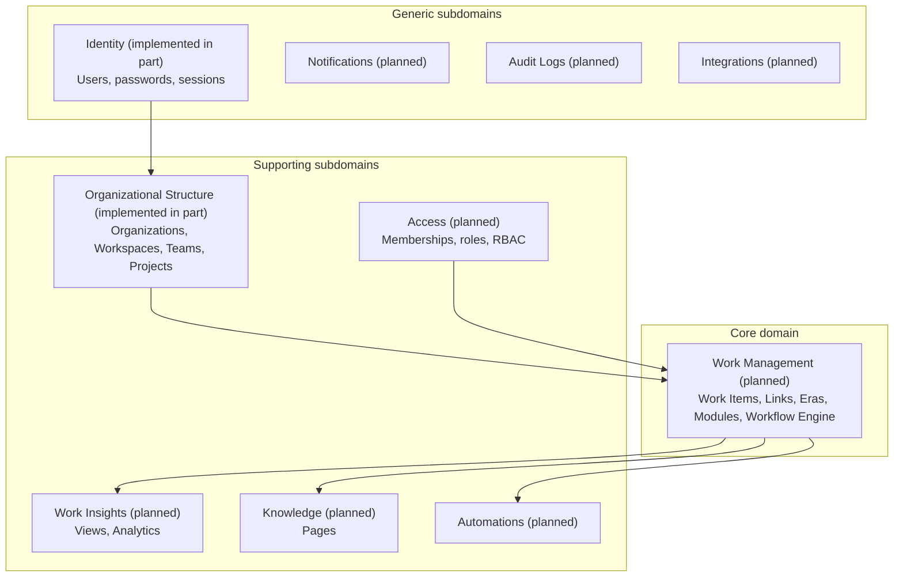

## How to read this map

- **Core** is where OpenBoard differentiates itself and where modeling effort goes first.
- **Supporting** subdomains have rules specific to OpenBoard, but exist to serve the core.
- **Generic** subdomains solve well-known problems, and must still run self-hosted without mandatory external services.

Arrows show which subdomain serves another. Planned subdomains appear only on this map until they have code.
